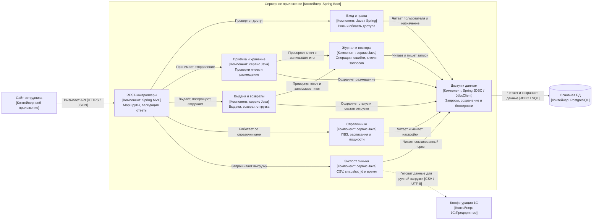

# C4 Component Diagram серверного приложения ПВЗ

**Уровень 3. Целевые компоненты контейнера Spring Boot.** Компоненты ниже описывают проектную декомпозицию [WP-API](work-packages.md#wp-api). Вход и права, приёмка, журнал и повторы приёмки, чтение ПВЗ и ячеек и экспорт снимка реализованы. Модули выдачи, возврата и редактирования справочников запланированы.

| Компонент | Задачи |
|---|---|
| REST-контроллеры | [T-02](delivery-plan.md#t-02), [T-07](delivery-plan.md#t-07), [T-13](delivery-plan.md#t-13), [T-15](delivery-plan.md#t-15) |
| Вход и права | [T-07](delivery-plan.md#t-07) |
| Приёмка и хранение | [T-07](delivery-plan.md#t-07), [T-17](delivery-plan.md#t-17) |
| Выдача и возвраты | [T-13](delivery-plan.md#t-13), [T-17](delivery-plan.md#t-17) |
| Справочники | [T-15](delivery-plan.md#t-15) |
| Журнал и повторы | [T-07](delivery-plan.md#t-07), [T-13](delivery-plan.md#t-13), [T-15](delivery-plan.md#t-15) |
| Экспорт снимка | [T-02](delivery-plan.md#t-02), [T-09](delivery-plan.md#t-09) |
| Доступ к данным | [T-01](delivery-plan.md#t-01), [T-07](delivery-plan.md#t-07), [T-09](delivery-plan.md#t-09), [T-13](delivery-plan.md#t-13), [T-15](delivery-plan.md#t-15), [T-17](delivery-plan.md#t-17) |

Сервисы операций сохраняют статус, размещение, запись об успешной операции и результат ключа повтора в одной транзакции. Журнал ошибок отказа сохраняется отдельно от откатываемой операции. Проверки прав, повторов и конкуренции описаны в [AC-05](acceptance.md#ac-05) и [AC-09](acceptance.md#ac-09).
