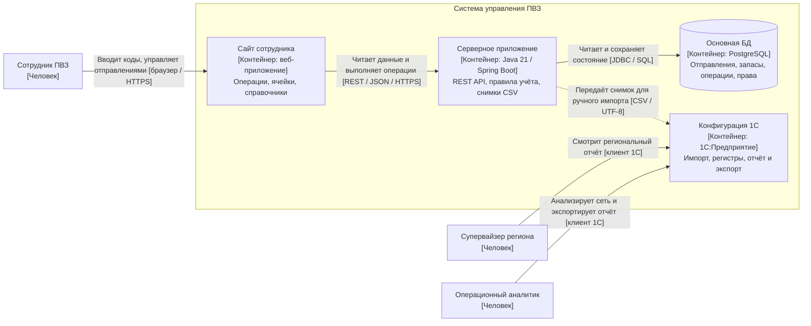

# C4 Container Diagram системы ПВЗ

**Уровень 2. Целевая архитектура MVP.** Граница соответствует [C4 Context](c4-context.md). Сайт, Spring Boot, PostgreSQL и учебная конфигурация 1С входят в продукт. Сайт приёмки обслуживает Spring Boot на том же адресе. PostgreSQL и приложение запускаются вместе по [инструкции](../README.md), работы по импорту и отчёту 1С запланированы. В MVP реальные внешние интеграции отсутствуют. Файлы снимка оператор переносит вручную по [ADR-001](adr/001-csv-snapshot.md).

Пакеты контейнеров — [WP-WEB](work-packages.md#wp-web), [WP-API](work-packages.md#wp-api), [WP-DB](work-packages.md#wp-db), [WP-1C](work-packages.md#wp-1c). Пунктир обозначает передачу файла через ручную выгрузку и форму импорта. Приёмка и выдача сохраняются через API и PostgreSQL независимо от доступности 1С. Содержимое API раскрыто на [C4 L3](c4-component.md).
