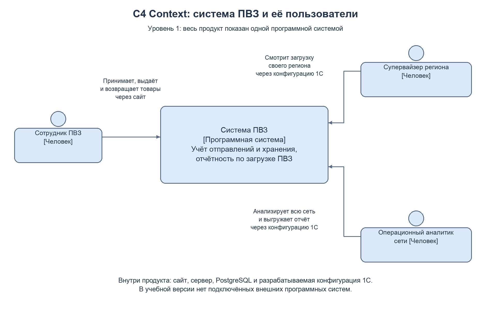

# C4 Context Diagram: окружение системы ПВЗ

Версия 1.0: 20.10.2026.

## Схема

Схема подготовлена по лекции «Основы проектной деятельности. Use Case + C4», слайды 35, 39, 43–44 и 61–65: люди, система, внешние системы и подписанные связи. Внутренние части системы на этом уровне не раскрываются.

## Граница системы

В центре схемы - весь продукт «Система ПВЗ»: сайт, сервер, основная база данных и разрабатываемая конфигурация 1С. На уровне C4 Context продукт показан одним блоком. Внутренние модули и обмен CSV на этой схеме не раскрываются.

Конфигурацию 1С разрабатывает команда, поэтому она не является внешней системой. Её форма загрузки, справочники, регистр и отчёт входят в общую границу продукта. Внутреннее устройство описано в [карточке проекта](card.md#5-архитектура-и-данные).

## Связи

| Актор | Система | Зачем взаимодействует |
|---|---|---|
| Сотрудник ПВЗ | Система ПВЗ | Через сайт вводит коды, принимает и выдаёт товары, оформляет возвраты и отгрузки; получает сведения о ячейках |
| Супервайзер региона | Система ПВЗ | Через конфигурацию 1С выбирает фильтры, смотрит загрузку своего региона и выгружает результат |
| Операционный аналитик сети | Система ПВЗ | Через конфигурацию 1С сравнивает все ПВЗ и регионы, смотрит и выгружает сводные данные |

Отчёт показывает данные на момент внутренней выгрузки. Номер и время выгрузки видны пользователю. Если конфигурация 1С недоступна, работа с товарами на сайте продолжается.

В учебной версии нет подключённых внешних программных систем. Реальные маркетплейсы, платежи, сканеры и геосервисы не входят в проект. Заказчик принимает результат, но не выполняет операции в продукте, поэтому на схеме пользователей не показан.

## Связанные материалы

- [Список акторов](actors.md).
- [Сценарии использования](use-cases.md).
- [Формат обмена с 1С: IF-02](requirements.md#if-02).
- [Описание уровня System Context в модели C4](https://c4model.com/diagrams/system-context).

Исходник изображения: [c4-context.drawio](images/c4-context.drawio).
