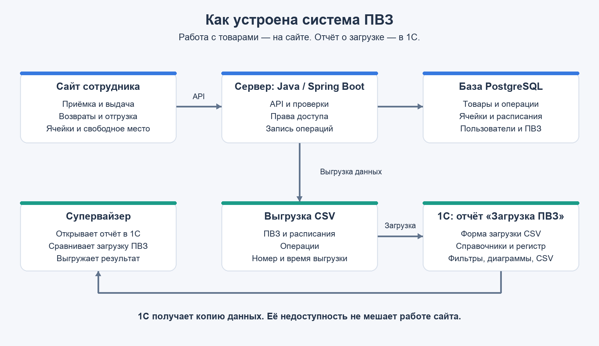

# Карточка проекта - Кейс 9: Пункты выдачи маркетплейса (ПВЗ)

**Версия:** 1.2: **Дата:** 17.10.2026.

## 1. О проекте

**Название:** система учёта товаров и анализа загрузки ПВЗ.

**Область:** интернет-торговля и логистика.

**Сроки:** 2026/27 учебный год; MVP - к 01.12.2026; полная учебная версия, защита и резерв исправлений - в мае, завершение не позднее 31.05.2027.

Сделать сайт, где сотрудник ПВЗ сможет принимать, выдавать и возвращать товары, готовить возвраты к отгрузке и учитывать свободное место. Серверная часть работает на Java/Spring Boot, данные хранятся в PostgreSQL. Для супервайзера в 1С строится отчёт «Загрузка ПВЗ».

Цель проекта — помочь супервайзеру увидеть перегруженные и малозагруженные точки. По отчёту он сможет решать, где нужны сотрудники или продвижение. Влияние таких решений проверяем на тестовых примерах: сам отчёт ещё не доказывает, что очереди стали меньше.

**Заказчик:** Борис Максимович Фёдоров.

**Общение с Заказчиком:** тимлид — Владимир.

**Пользователи:** сотрудник своей точки, супервайзер региона, операционный аналитик сети.

**Источник требований:** кейс 9, бизнес-потребности Заказчика и проектные решения команды.

## 2. Команда

| Участник | Профиль Gitverse | Роль | Основной результат |
|---|---|---|---|
| Бирюков Алексей Сергеевич | - | Аналитик, BA/SA | Анализ процессов, уточнение требований, BPMN, приёмка, KPI |
| Ксенофонтова Элла Сергеевна | [@EllaKsenofontova](https://gitverse.ru/EllaKsenofontova) | Фуллстек, 1С, дизайн | Дизайн и UI-компоненты, справочники на сайте, импорт и отчёт 1С |
| Новиков Владимир Дмитриевич | [@novd7](https://gitverse.ru/novd7) | Тимлид / Project Lead, фуллстек | Проектная документация, архитектура, БД, приёмка и хранение, API, релизы |
| Дашковский Николай Андреевич | [@HTechn](https://gitverse.ru/HTechn) | Фуллстек | БД и миграции модулей, выдача, возвраты, отгрузка и интерфейс |
| Бобрушко Тимур Алексеевич | [@Sunic11](https://gitverse.ru/Sunic11) | Фуллстек | Java-модуль генерации тестовых данных и валидации CSV, быстрые проверки основных функций |

Руководство проектом закреплено за Владимиром. Фуллстек-разработчики отвечают за свои части проекта: серверную логику, данные и экраны. Подробности: [роли и RACI](roles-raci.md).

## 3. KPI и критерии успеха

Загрузку считаем по часам в часовом поясе Europe/Moscow. Учитываем каждый рабочий час, даже если операций не было. Допустимое число операций в час (`capacity_per_hour`) должно быть больше нуля. Приёмка, выдача и возврат считаются одинаково: одно действие — одна операция.

| Показатель | Формула и единицы | Плановый порог | Способ проверки |
|---|---|---|---|
| Часовая загрузка | `100 × ops_per_hour / capacity_per_hour`, % | Перегрузка строго >100% | Независимый эталон, [AC-06](acceptance.md#ac-06) |
| Доля перегруженных интервалов | `100 × число рабочих часов с load>100% / число рабочих часов`, % | ≤10% в тестовом варианте после перераспределения операций | T2 до/после, то же общее число операций, [AC-08](acceptance.md#ac-08) |
| Средняя загрузка в пик | Среднее часовых load по рабочим часам 18:00–21:00, % | Для сравнения точек, без заданного порога | Срез T2 по одинаковому периоду; часы пика 18:00–21:00 |
| Корректность отчёта | Совпадение числа операций, допустимой нагрузки и признаков перегрузки; отклонение load от эталона | 100% строк; отклонение load ≤0,01 процентного пункта | [AC-06](acceptance.md#ac-06), T1 при доступности и собственный T2 |
| Работоспособность MVP | Пройденные обязательные AC / все обязательные AC | 100%, без критических ошибок | [AC-01](acceptance.md#ac-01), [AC-02](acceptance.md#ac-02), [AC-03](acceptance.md#ac-03), [AC-04](acceptance.md#ac-04), [AC-05](acceptance.md#ac-05), [AC-06](acceptance.md#ac-06), [AC-07](acceptance.md#ac-07), [AC-08](acceptance.md#ac-08), [AC-09](acceptance.md#ac-09), [AC-10](acceptance.md#ac-10), протокол демо |

Если рабочих часов нет - KPI «нет данных», а не 0%. Дневная загрузка в процентах — 100 × сумма ops / сумма часовых capacity; нельзя сравнивать дневное число операций с мощностью одного часа. Частичные часы для MVP не поддерживаются: расписание задаётся целыми часами. Цели и правила фильтрации: [требования](requirements.md).

## 4. Границы MVP

**Включено:**

1. Приёмка отправления по вручную введённому уникальному коду с размещением в ячейке.
2. Выдача по коду получения.
3. Приём возврата по коду возврата.
4. Формирование и подтверждение отгрузки возвратов.
5. Отчёт «Загрузка ПВЗ» с фильтрами, диаграммами и выгрузкой.

**Для работы этих функций нужны:**

- вход и права доступа;
- расписания и допустимое число операций в час;
- ячейки и учёт объёма товаров;
- статусы отправлений;
- журнал операций и ошибок;
- повторная загрузка тестовых данных.

**Обязательная часть в 1С:**

- форма загрузки данных;
- справочники и регистр операций;
- отчёт «Загрузка ПВЗ»;
- загрузка и выгрузка CSV.

MVP обеспечивает выполнение всех перечисленных действий.

**До конца учебного года:** удобство обработки нескольких товаров сразу, расширенное хранение, сверка наличия товаров, сроки хранения, аналитические сравнения и объяснимые подсказки, автоматизация учебного обмена с 1С. Детализация Should выполняется после выпуска MVP в рамках установленного годового объёма.

**Вне учебного продукта:** реальные сканеры, терминалы и геосервисы; реальные маркетплейсы, платежи, персональные данные клиентов, промышленное внедрение. Весной добавляем обмен между своими частями системы или заглушками внешних сервисов. Автоматическое изменение рекламы и обещание роста узнаваемости не входят в объём.

## 5. Архитектура и данные

Основные данные хранятся в PostgreSQL. Для отчёта сервер выгружает CSV, которые загружаются в 1С.

Если 1С недоступна, сотрудники продолжают работать на сайте. Повторная загрузка одной выгрузки не создаёт дубли операций.

Основные данные: ПВЗ, расписание, пользователь и назначение на точки/регионы, отправление, ячейка, операция, возвратная отгрузка и её состав. Обязательны ERD ≥5 сущностей, BPMN процесса и словарь данных; их разработка запланирована на [W3](roadmap.md#w3).

Данные только тестовые; файлы обмена — CSV в кодировке UTF-8, сообщения API — JSON. Кафедральный T1 запрашивается у Заказчика; до получения используются явно обозначенные собственные T2 и invalid. Целевой T2: 100 ПВЗ, ≥700 расписаний, ≥1000 отправлений, ≥5000 операций, ≥100 ячеек. Валидации: обязательность, уникальность кодов/операций, FK, допустимые типы, расписание, положительная мощность/объём, допустимые статусы, вместимость. Различие между кейсом и приложением C9 описано в [основании](README.md).

## 6. Основные риски

| Риск | Мера | Ответственный |
|---|---|---|
| Базовые функции 1С окажутся сложнее ожидаемого | Проверить доступ и импорт на [W1](roadmap.md#w1); проверка пути от операции до отчёта на [W3](roadmap.md#w3), [W4](roadmap.md#w4) | Элла |
| Расширение объёма сорвёт декабрьский MVP | Заморозка Must на [W2](roadmap.md#w2); Should - после приёмки MVP | Владимир |
| Несовместимые определения загрузки в кейсе/C9 | Зафиксировать почасовую формулу и согласовать T1/эталон | Алексей |

Полный [реестр рисков](risks.md). Основание и проектные решения приведены в [составе документации](README.md).

## 7. Ответственность и календарь

Мини-RACI: базовый комплект документации - R/A Владимир; анализ и BPMN - R/A Алексей; БД/ERD - R Владимир и Николай, A Владимир; дизайн, справочники на сайте и 1С - R Элла, A Владимир; выдача/возвраты/отгрузка - R Николай, A Владимир; генератор данных, валидатор CSV и быстрые проверки основных функций - R Тимур, A Владимир. Заказчик утверждает объём и принимает результат. [Полная матрица и параллельные направления работ](roles-raci.md).

[W1](roadmap.md#w1) - карточка/доступ 1С; [W2](roadmap.md#w2) - требования/AC/схема; [W3](roadmap.md#w3) - BPMN/ERD, UI, данные, импорт; [W4](roadmap.md#w4) - операция на сайте и её отражение в отчёте; [W5](roadmap.md#w5) - v0.1; [W6](roadmap.md#w6) - работающий MVP к 01.12; [W7](roadmap.md#w7) - доказательства/репетиция; [W8](roadmap.md#w8) - учебный v1.0 и защита. [Годовой Roadmap](roadmap.md).

## 8. Приёмка и ссылки

Обязательные критерии: [AC-01](acceptance.md#ac-01), [AC-02](acceptance.md#ac-02), [AC-03](acceptance.md#ac-03), [AC-04](acceptance.md#ac-04), [AC-05](acceptance.md#ac-05), [AC-06](acceptance.md#ac-06), [AC-07](acceptance.md#ac-07), [AC-08](acceptance.md#ac-08), [AC-09](acceptance.md#ac-09), [AC-10](acceptance.md#ac-10). Реестр требований: [MoSCoW](requirements.md). План разработки: [Roadmap](roadmap.md). Распределение ответственности: [RACI](roles-raci.md).

Структура проекта: `docs` - документация и модели; `data/C09` - T1, T2 и invalid; `spec` - API и схемы обмена; `ui` - веб-интерфейс; `src` - серверная часть; `src-1c` - объекты 1С; `qa` - эталоны и протоколы; `docs/release` - комплект защиты.
