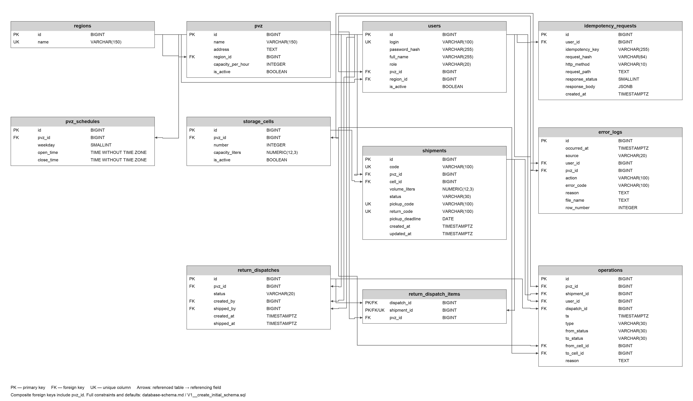
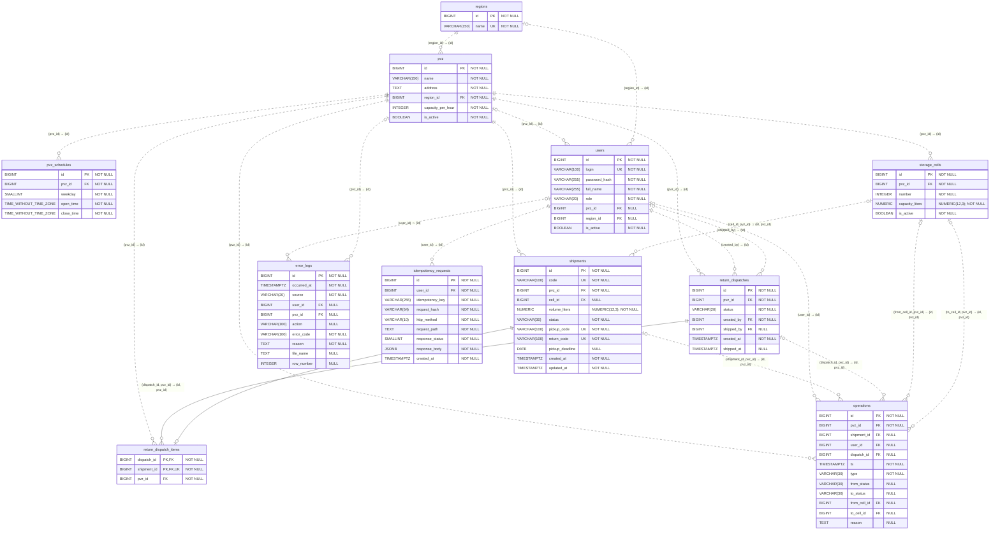

# Схема базы данных

Источник: [V1__create_initial_schema.sql](../backend/src/main/resources/db/migration/V1__create_initial_schema.sql). Схема отражает только эту миграцию PostgreSQL.

## Графическая схема



[SVG](images/database-schema.svg) · [Редактировать в diagrams.net](images/database-schema.drawio)

Стрелки направлены от родительской таблицы к полю внешнего ключа. Для составных внешних ключей стрелка указывает на основное поле; `pvz_id` также входит в связь, как показано в Mermaid и DDL ниже.

## ER-диаграмма

`PK` — первичный ключ, `FK` — внешний ключ, `UK` — уникальность отдельного поля; `NOT NULL` — обязательное поле. Составные ограничения `UNIQUE`, значения по умолчанию, проверки `CHECK` и индексы приведены в точном DDL ниже. В типах на диаграмме пробелы заменены подчёркиваниями; точность и масштаб `NUMERIC(12,3)` указаны в комментарии поля.

На каждой связи указаны поля внешнего ключа и соответствующие поля родительской таблицы. `||` означает ровно одну запись, `o|` — ноль или одну, `o{` — ноль или больше. Обязательность связей показана по `NOT NULL`; дополнительные условия `CHECK` зависят от роли или состояния записи.



## Особенности связей

- Составные внешние ключи с `pvz_id` обеспечивают принадлежность ячейки, отправления и отгрузки тому же ПВЗ.
- У `return_dispatch_items` составной первичный ключ `(dispatch_id, shipment_id)`. Уникальность `shipment_id` допускает не более одной строки состава отгрузки для каждого отправления.
- Связи пользователя с ПВЗ и регионом зависят от роли: `EMPLOYEE` имеет только `pvz_id`, `SUPERVISOR` — только `region_id`, `ANALYST` — ни одного из них.
- `cell_id` обязателен для `STORED` и `RETURN_STORED` и отсутствует для остальных разрешённых состояний. Для `STORED` также обязателен `pickup_deadline`.
- Внешние ключи не задают `ON DELETE` и `ON UPDATE`: применяется стандартное поведение PostgreSQL `NO ACTION`.
- Даты событий имеют тип `TIMESTAMPTZ`; расписание и срок получения интерпретируются в `Europe/Moscow`. Правила, выполняемые сервисом, указаны в комментариях исходного DDL.

## Точное определение схемы

Ниже приведено полное содержимое исходной миграции без изменений: все поля, типы, `IDENTITY`, первичные и внешние ключи, составные ограничения, проверки, значения по умолчанию, индексы и комментарии.

```sql
-- Начальная схема ПВЗ. Все даты событий хранятся как TIMESTAMPTZ.
-- Расписание и срок получения интерпретируются в Europe/Moscow.

CREATE TABLE regions (
    id BIGINT GENERATED BY DEFAULT AS IDENTITY PRIMARY KEY,
    name VARCHAR(150) NOT NULL UNIQUE,
    CONSTRAINT ck_regions_name CHECK (btrim(name) <> '')
);

CREATE TABLE pvz (
    id BIGINT GENERATED BY DEFAULT AS IDENTITY PRIMARY KEY,
    name VARCHAR(150) NOT NULL,
    address TEXT NOT NULL,
    region_id BIGINT NOT NULL REFERENCES regions (id),
    capacity_per_hour INTEGER NOT NULL,
    is_active BOOLEAN NOT NULL DEFAULT TRUE,
    CONSTRAINT ck_pvz_name CHECK (btrim(name) <> ''),
    CONSTRAINT ck_pvz_address CHECK (btrim(address) <> ''),
    CONSTRAINT ck_pvz_capacity CHECK (capacity_per_hour > 0)
);

CREATE INDEX ix_pvz_region ON pvz (region_id);

CREATE TABLE pvz_schedules (
    id BIGINT GENERATED BY DEFAULT AS IDENTITY PRIMARY KEY,
    pvz_id BIGINT NOT NULL REFERENCES pvz (id),
    weekday SMALLINT NOT NULL,
    open_time TIME WITHOUT TIME ZONE NOT NULL,
    close_time TIME WITHOUT TIME ZONE NOT NULL,
    CONSTRAINT uq_pvz_schedules_day UNIQUE (pvz_id, weekday),
    CONSTRAINT ck_pvz_schedules_weekday CHECK (weekday BETWEEN 0 AND 6),
    CONSTRAINT ck_pvz_schedules_interval CHECK (open_time < close_time),
    CONSTRAINT ck_pvz_schedules_whole_hours CHECK (
        EXTRACT(MINUTE FROM open_time) = 0
        AND EXTRACT(SECOND FROM open_time) = 0
        AND EXTRACT(MINUTE FROM close_time) = 0
        AND EXTRACT(SECOND FROM close_time) = 0
    )
);

CREATE TABLE users (
    id BIGINT GENERATED BY DEFAULT AS IDENTITY PRIMARY KEY,
    login VARCHAR(100) NOT NULL UNIQUE,
    password_hash VARCHAR(255) NOT NULL,
    full_name VARCHAR(255) NOT NULL,
    role VARCHAR(20) NOT NULL,
    pvz_id BIGINT REFERENCES pvz (id),
    region_id BIGINT REFERENCES regions (id),
    is_active BOOLEAN NOT NULL DEFAULT TRUE,
    CONSTRAINT ck_users_login CHECK (btrim(login) <> ''),
    CONSTRAINT ck_users_password_hash CHECK (btrim(password_hash) <> ''),
    CONSTRAINT ck_users_full_name CHECK (btrim(full_name) <> ''),
    CONSTRAINT ck_users_role_scope CHECK (
        (role = 'EMPLOYEE' AND pvz_id IS NOT NULL AND region_id IS NULL)
        OR (role = 'SUPERVISOR' AND pvz_id IS NULL AND region_id IS NOT NULL)
        OR (role = 'ANALYST' AND pvz_id IS NULL AND region_id IS NULL)
    )
);

CREATE INDEX ix_users_pvz ON users (pvz_id);
CREATE INDEX ix_users_region ON users (region_id);

CREATE TABLE storage_cells (
    id BIGINT GENERATED BY DEFAULT AS IDENTITY PRIMARY KEY,
    pvz_id BIGINT NOT NULL REFERENCES pvz (id),
    number INTEGER NOT NULL,
    capacity_liters NUMERIC(12, 3) NOT NULL,
    is_active BOOLEAN NOT NULL DEFAULT TRUE,
    CONSTRAINT uq_storage_cells_number UNIQUE (pvz_id, number),
    -- Составной ключ позволяет запрещать ссылки на ячейки чужой точки.
    CONSTRAINT uq_storage_cells_id_pvz UNIQUE (id, pvz_id),
    CONSTRAINT ck_storage_cells_number CHECK (number > 0),
    CONSTRAINT ck_storage_cells_capacity CHECK (
        capacity_liters > 0 AND capacity_liters <> 'NaN'::NUMERIC
    )
);

CREATE TABLE shipments (
    id BIGINT GENERATED BY DEFAULT AS IDENTITY PRIMARY KEY,
    code VARCHAR(100) NOT NULL UNIQUE,
    pvz_id BIGINT NOT NULL REFERENCES pvz (id),
    cell_id BIGINT,
    volume_liters NUMERIC(12, 3) NOT NULL,
    status VARCHAR(30) NOT NULL DEFAULT 'EXPECTED',
    pickup_code VARCHAR(100) NOT NULL UNIQUE,
    return_code VARCHAR(100) NOT NULL UNIQUE,
    pickup_deadline DATE,
    created_at TIMESTAMPTZ NOT NULL DEFAULT CURRENT_TIMESTAMP,
    updated_at TIMESTAMPTZ NOT NULL DEFAULT CURRENT_TIMESTAMP,
    CONSTRAINT uq_shipments_id_pvz UNIQUE (id, pvz_id),
    CONSTRAINT fk_shipments_cell_pvz FOREIGN KEY (cell_id, pvz_id)
        REFERENCES storage_cells (id, pvz_id),
    CONSTRAINT ck_shipments_code CHECK (btrim(code) <> ''),
    CONSTRAINT ck_shipments_pickup_code CHECK (btrim(pickup_code) <> ''),
    CONSTRAINT ck_shipments_return_code CHECK (btrim(return_code) <> ''),
    CONSTRAINT ck_shipments_volume CHECK (
        volume_liters > 0 AND volume_liters <> 'NaN'::NUMERIC
    ),
    CONSTRAINT ck_shipments_status CHECK (
        status IN ('EXPECTED', 'STORED', 'ISSUED', 'RETURN_STORED', 'RETURN_SHIPPED')
    ),
    CONSTRAINT ck_shipments_placement CHECK (
        (status IN ('STORED', 'RETURN_STORED') AND cell_id IS NOT NULL)
        OR (status IN ('EXPECTED', 'ISSUED', 'RETURN_SHIPPED') AND cell_id IS NULL)
    ),
    CONSTRAINT ck_shipments_pickup_deadline CHECK (
        status <> 'STORED' OR pickup_deadline IS NOT NULL
    )
);

CREATE INDEX ix_shipments_pvz_status ON shipments (pvz_id, status);
CREATE INDEX ix_shipments_cell ON shipments (cell_id);
CREATE INDEX ix_shipments_pickup_deadline ON shipments (pvz_id, pickup_deadline)
    WHERE status = 'STORED';

CREATE TABLE return_dispatches (
    id BIGINT GENERATED BY DEFAULT AS IDENTITY PRIMARY KEY,
    pvz_id BIGINT NOT NULL REFERENCES pvz (id),
    status VARCHAR(20) NOT NULL DEFAULT 'DRAFT',
    created_by BIGINT NOT NULL REFERENCES users (id),
    shipped_by BIGINT REFERENCES users (id),
    created_at TIMESTAMPTZ NOT NULL DEFAULT CURRENT_TIMESTAMP,
    shipped_at TIMESTAMPTZ,
    CONSTRAINT uq_return_dispatches_id_pvz UNIQUE (id, pvz_id),
    CONSTRAINT ck_return_dispatches_state CHECK (
        (status = 'DRAFT' AND shipped_at IS NULL AND shipped_by IS NULL)
        OR (status = 'SHIPPED' AND shipped_at IS NOT NULL AND shipped_by IS NOT NULL)
    ),
    CONSTRAINT ck_return_dispatches_dates CHECK (shipped_at >= created_at)
);

CREATE INDEX ix_return_dispatches_pvz_status ON return_dispatches (pvz_id, status);

CREATE TABLE return_dispatch_items (
    dispatch_id BIGINT NOT NULL,
    shipment_id BIGINT NOT NULL,
    pvz_id BIGINT NOT NULL REFERENCES pvz (id),
    PRIMARY KEY (dispatch_id, shipment_id),
    -- В MVP отправление проходит один цикл возврата.
    CONSTRAINT uq_return_dispatch_items_shipment UNIQUE (shipment_id),
    CONSTRAINT fk_return_dispatch_items_dispatch FOREIGN KEY (dispatch_id, pvz_id)
        REFERENCES return_dispatches (id, pvz_id),
    CONSTRAINT fk_return_dispatch_items_shipment FOREIGN KEY (shipment_id, pvz_id)
        REFERENCES shipments (id, pvz_id)
);

CREATE TABLE operations (
    id BIGINT GENERATED BY DEFAULT AS IDENTITY PRIMARY KEY,
    pvz_id BIGINT NOT NULL REFERENCES pvz (id),
    -- CSV для аналитики не содержит отправление и пользователя.
    -- Для операций через API оба поля заполняются сервисом.
    shipment_id BIGINT,
    user_id BIGINT REFERENCES users (id),
    dispatch_id BIGINT,
    ts TIMESTAMPTZ NOT NULL DEFAULT CURRENT_TIMESTAMP,
    type VARCHAR(30) NOT NULL,
    from_status VARCHAR(30),
    to_status VARCHAR(30),
    from_cell_id BIGINT,
    to_cell_id BIGINT,
    reason TEXT,
    CONSTRAINT fk_operations_shipment_pvz FOREIGN KEY (shipment_id, pvz_id)
        REFERENCES shipments (id, pvz_id),
    CONSTRAINT fk_operations_dispatch_pvz FOREIGN KEY (dispatch_id, pvz_id)
        REFERENCES return_dispatches (id, pvz_id),
    CONSTRAINT fk_operations_from_cell_pvz FOREIGN KEY (from_cell_id, pvz_id)
        REFERENCES storage_cells (id, pvz_id),
    CONSTRAINT fk_operations_to_cell_pvz FOREIGN KEY (to_cell_id, pvz_id)
        REFERENCES storage_cells (id, pvz_id),
    CONSTRAINT ck_operations_type CHECK (
        type IN ('RECEIPT', 'ISSUE', 'CUSTOMER_RETURN', 'RETURN_DISPATCH')
    ),
    CONSTRAINT ck_operations_from_status CHECK (
        from_status IN ('EXPECTED', 'STORED', 'ISSUED', 'RETURN_STORED', 'RETURN_SHIPPED')
    ),
    CONSTRAINT ck_operations_to_status CHECK (
        to_status IN ('EXPECTED', 'STORED', 'ISSUED', 'RETURN_STORED', 'RETURN_SHIPPED')
    ),
    CONSTRAINT ck_operations_dispatch_type CHECK (
        dispatch_id IS NULL OR type = 'RETURN_DISPATCH'
    )
);

CREATE INDEX ix_operations_pvz_ts ON operations (pvz_id, ts);
CREATE INDEX ix_operations_shipment_ts ON operations (shipment_id, ts);
CREATE INDEX ix_operations_dispatch ON operations (dispatch_id);

CREATE TABLE error_logs (
    id BIGINT GENERATED BY DEFAULT AS IDENTITY PRIMARY KEY,
    occurred_at TIMESTAMPTZ NOT NULL DEFAULT CURRENT_TIMESTAMP,
    source VARCHAR(20) NOT NULL,
    user_id BIGINT REFERENCES users (id),
    pvz_id BIGINT REFERENCES pvz (id),
    action VARCHAR(100),
    error_code VARCHAR(100) NOT NULL,
    reason TEXT NOT NULL,
    file_name TEXT,
    row_number INTEGER,
    CONSTRAINT ck_error_logs_source CHECK (source IN ('OPERATION', 'IMPORT')),
    CONSTRAINT ck_error_logs_code CHECK (btrim(error_code) <> ''),
    CONSTRAINT ck_error_logs_reason CHECK (btrim(reason) <> ''),
    CONSTRAINT ck_error_logs_row CHECK (row_number > 0)
);

CREATE INDEX ix_error_logs_pvz_time ON error_logs (pvz_id, occurred_at);

CREATE TABLE idempotency_requests (
    id BIGINT GENERATED BY DEFAULT AS IDENTITY PRIMARY KEY,
    user_id BIGINT NOT NULL REFERENCES users (id),
    idempotency_key VARCHAR(255) NOT NULL,
    request_hash VARCHAR(64) NOT NULL,
    http_method VARCHAR(10) NOT NULL,
    request_path TEXT NOT NULL,
    response_status SMALLINT NOT NULL,
    response_body JSONB NOT NULL,
    created_at TIMESTAMPTZ NOT NULL DEFAULT CURRENT_TIMESTAMP,
    CONSTRAINT uq_idempotency_requests_user_key UNIQUE (user_id, idempotency_key),
    CONSTRAINT ck_idempotency_requests_key CHECK (btrim(idempotency_key) <> ''),
    CONSTRAINT ck_idempotency_requests_hash CHECK (request_hash ~ '^[0-9a-f]{64}$'),
    CONSTRAINT ck_idempotency_requests_response CHECK (response_status BETWEEN 100 AND 599)
);

COMMENT ON COLUMN storage_cells.number IS 'Положительный номер, уникальный внутри ПВЗ';
COMMENT ON COLUMN pvz.capacity_per_hour IS
    'Мощность для расчёта нагрузки; превышение не запрещает операции';
COMMENT ON COLUMN shipments.pickup_deadline IS
    'Последний день получения включительно, Europe/Moscow; истечение не освобождает ячейку';
COMMENT ON TABLE operations IS
    'Успешные события; RETURN_DISPATCH записывается для каждого отправления отгрузки';
COMMENT ON TABLE error_logs IS
    'Ошибки операций и импорта; сервис не должен записывать пароли и клиентские коды';
COMMENT ON TABLE idempotency_requests IS
    'Результат запроса сохраняется атомарно с изменениями; хеш включает метод, путь и тело';

-- Проверка расписания, прав, переходов состояний, состава отгрузки и вместимости
-- выполняется сервисом в транзакции. Перед изменением размещения блокируются
-- отправление и затронутые ячейки; занятый объём считается по shipments.
-- updated_at обновляется сервисом при каждом изменении отправления.
-- При импорте явных id необходимо синхронизировать соответствующие sequence.
```
