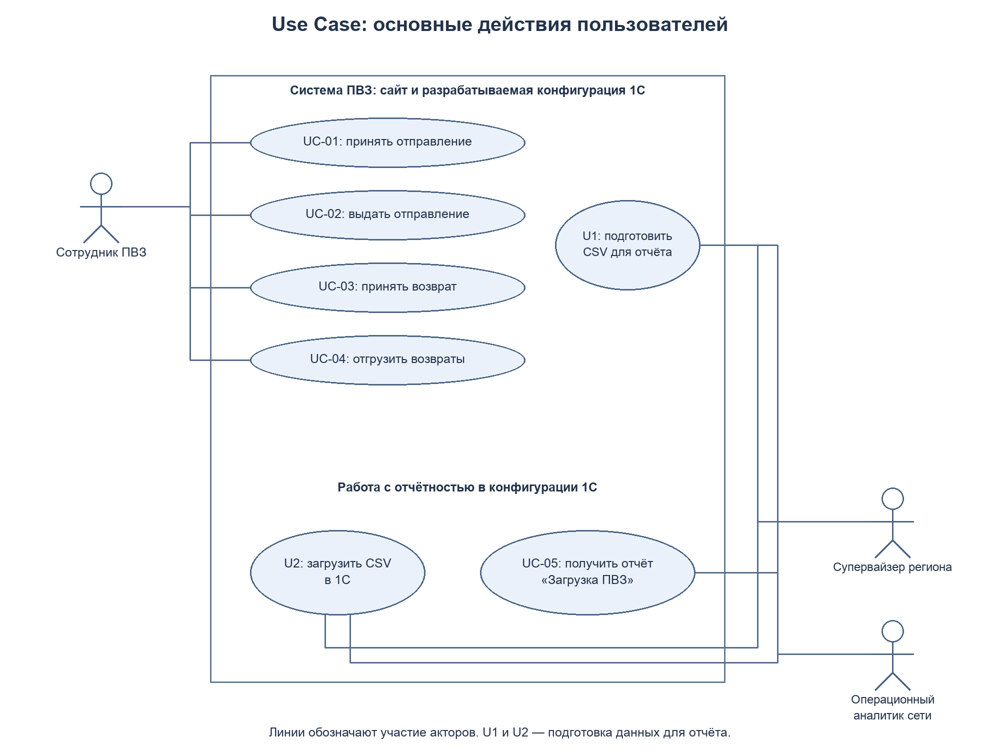

# Use Case: сценарии работы ПВЗ

Версия 1.0: 20.10.2026.

## Диаграмма вариантов использования

На диаграмме одна граница — «Система ПВЗ», включающая сайт, сервер, базу данных и разрабатываемую конфигурацию 1С. Акторы находятся снаружи, все действия — внутри этой границы. Линии показывают, кто выполняет действие. Порядок шагов описан ниже, а не стрелками между действиями.

Вспомогательные действия U1 и U2 нужны, чтобы подготовить данные для UC-05. Формирование отчёта не включает импорт при каждом открытии: можно повторно работать с уже загруженным набором. Возврат и отгрузка показаны отдельными действиями, поскольку выполняются в разное время. Вход в систему — условие начала работы, а не отдельная цель этих сценариев.

Источник оформления: лекция «Основы проектной деятельности. Use Case + C4», слайды 22–30. Пользователи и ограничения описаны в [списке акторов](actors.md). Схема окружения — [C4 Context](c4-context.md).

| Сценарий | Цель | Основной актор |
|---|---|---|
| UC-01 | Принять отправление и разместить в ячейке | Сотрудник ПВЗ |
| UC-02 | Выдать отправление | Сотрудник ПВЗ |
| UC-03 | Принять возврат | Сотрудник ПВЗ |
| UC-04 | Подтвердить отгрузку возвратов | Сотрудник ПВЗ |
| UC-05 | Получить отчёт о загрузке ПВЗ | Супервайзер региона; тот же сценарий доступен операционному аналитику сети |

## UC-01: Принять отправление

**Система:** Система ПВЗ, работа через сайт.

**Основной актор:** Сотрудник ПВЗ.

**Цель:** Зафиксировать поступление отправления и его место хранения.

**Условия начала:** Сотрудник вошёл в систему и работает со своей точкой. ПВЗ открыт по расписанию. Отправление заранее создано в тестовых данных со статусом EXPECTED. У него задан положительный объём.

**Начало сценария:** Сотрудник получил отправление и начинает приёмку.

### Основные шаги

1. Сотрудник открывает приёмку и вручную вводит код отправления.
2. Система находит отправление, проверяет его статус, точку и часы работы.
3. Система показывает данные отправления и ячейки, в которых есть место.
4. Сотрудник выбирает ячейку и подтверждает приёмку.
5. Система повторно проверяет свободный объём и сохраняет вместе статус STORED, размещение и операцию in.
6. Сотрудник видит результат и номер ячейки.

### Другие варианты и ошибки

| Ситуация | Действие системы или пользователя |
|---|---|
| Код неизвестен | Система сообщает, что отправление не найдено. Сотрудник исправляет код или завершает действие. |
| Чужой ПВЗ, закрытое время или неверный статус | Система отклоняет приёмку и записывает причину в журнал. |
| Нет свободного объёма | Приёмка не сохраняется. Сотрудник выбирает другую подходящую ячейку; если места нет, завершает действие. |
| Повтор или одновременная приёмка | Второй запрос не создаёт ещё одну операцию и не занимает место повторно. |

**Результат:** Отправление хранится в выбранной ячейке. Статус — STORED. Создана ровно одна операция in, занятый объём увеличен один раз. При отказе связанные данные не меняются.

**Связь с требованиями:** [FR-03](requirements.md#fr-03), [FR-07](requirements.md#fr-07), [NFR-02](requirements.md#nfr-02); проверка — [AC-02](acceptance.md#ac-02).

## UC-02: Выдать отправление

**Система:** Система ПВЗ, работа через сайт.

**Основной актор:** Сотрудник ПВЗ.

**Цель:** Передать отправление получателю и освободить место хранения.

**Условия начала:** Сотрудник вошёл в систему своей точки. ПВЗ открыт. Отправление имеет статус STORED; для него существует код получения.

**Начало сценария:** Получатель сообщает код сотруднику.

### Основные шаги

1. Сотрудник открывает выдачу и вручную вводит код получения.
2. Система проверяет код, права, точку, расписание и статус отправления.
3. Система показывает отправление и его ячейку.
4. Сотрудник находит отправление, передаёт его получателю и подтверждает выдачу.
5. Система сохраняет вместе статус ISSUED, операцию out и освобождение места.
6. Сотрудник видит подтверждение выдачи.

### Другие варианты и ошибки

| Ситуация | Действие системы или пользователя |
|---|---|
| Неверный код | Система не находит отправление по коду. Сотрудник может исправить ввод. |
| Выдача уже выполнена | Новая операция out не создаётся, место повторно не освобождается. |
| Нет прав, ПВЗ закрыт или статус не STORED | Система отказывает и показывает причину. |
| Два запроса одновременно | Успешна только одна выдача; другой запрос получает сообщение о конфликте. |

**Результат:** Отправление имеет статус ISSUED. Записана одна операция out, занятый объём ячейки уменьшен на объём отправления. При отказе данные сохраняются в прежнем состоянии.

**Связь с требованиями:** [FR-04](requirements.md#fr-04), [NFR-02](requirements.md#nfr-02); проверка — [AC-03](acceptance.md#ac-03).

## UC-03: Принять возврат

**Система:** Система ПВЗ, работа через сайт.

**Основной актор:** Сотрудник ПВЗ.

**Цель:** Учесть возвращённое отправление и разместить его до отгрузки.

**Условия начала:** Сотрудник вошёл в систему своей точки. ПВЗ открыт. Отправление ранее выдано (ISSUED), код возврата есть в тестовых данных. В подходящей ячейке достаточно места.

**Начало сценария:** Получатель передаёт товар и сообщает код возврата.

### Основные шаги

1. Сотрудник открывает возвраты и вручную вводит код возврата.
2. Система находит отправление и проверяет код, статус, принадлежность своей точке, права и часы работы.
3. Сотрудник выбирает подходящую ячейку.
4. Сотрудник подтверждает приём возврата.
5. Система вместе сохраняет статус RETURN_STORED, операцию return и занятый объём.
6. Сотрудник видит подтверждение и ячейку возврата.

### Другие варианты и ошибки

| Ситуация | Действие системы или пользователя |
|---|---|
| Код неверен или возврат уже принят | Система отклоняет повторное действие, не создаёт ещё одну запись и не занимает место повторно. |
| Недостаточно места | Сотрудник выбирает другую ячейку или завершает действие без сохранения. |
| Нет прав или ПВЗ закрыт | Система отказывает и записывает причину в журнал. |
| Отправление не в ISSUED | Система отклоняет этот путь. Перевод невостребованного отправления в возврат — отдельный вариант ниже. |

**Результат:** Статус — RETURN_STORED, возврат лежит в ячейке. Записана одна операция return. Место остаётся занятым до отгрузки.

**Связь с требованиями:** [FR-05](requirements.md#fr-05), [FR-07](requirements.md#fr-07); проверка — [AC-04](acceptance.md#ac-04).

## UC-04: Отгрузить возвраты

**Система:** Система ПВЗ, работа через сайт.

**Основной актор:** Сотрудник ПВЗ.

**Цель:** Зафиксировать отправку возвратов с ПВЗ.

**Условия начала:** Сотрудник вошёл в систему своей точки. ПВЗ открыт. Есть отправления RETURN_STORED, которые не включены в другую активную отгрузку.

**Начало сценария:** Сотрудник готовит возвраты к передаче курьеру.

### Основные шаги

1. Сотрудник открывает отгрузки возвратов и создаёт черновик DRAFT.
2. Система показывает доступные возвраты своей точки.
3. Сотрудник добавляет отправления и проверяет состав.
4. После фактической передачи сотрудник подтверждает отгрузку.
5. Система повторно проверяет состав и сохраняет вместе SHIPPED для отгрузки, RETURN_SHIPPED для отправлений и освобождение мест.
6. Система записывает действие return_dispatch в журнал и показывает результат.

### Другие варианты и ошибки

| Ситуация | Действие системы или пользователя |
|---|---|
| Чужая точка или неверный статус | Такое отправление нельзя включить в отгрузку. |
| Отправление уже в другой активной отгрузке | Система сообщает о конфликте и не дублирует состав. |
| Пустой черновик | Подтверждение запрещено до добавления отправлений. |
| Отгрузка уже подтверждена | Повтор не меняет статусы и не освобождает место второй раз. |
| Ошибка при подтверждении | Ни одна часть отгрузки не сохраняется отдельно. После устранения причины действие можно повторить. |

**Результат:** Отгрузка имеет статус SHIPPED, все её отправления — RETURN_SHIPPED. Их места освобождены один раз. Действие return_dispatch не добавляет второй return в расчёт нагрузки.

**Связь с требованиями:** [FR-06](requirements.md#fr-06), [NFR-02](requirements.md#nfr-02); проверка — [AC-04](acceptance.md#ac-04).

## UC-05: Получить отчёт «Загрузка ПВЗ»

**Система:** Система ПВЗ, работа через разрабатываемую конфигурацию 1С.

**Основной актор:** Супервайзер региона.

**Цель:** Сравнить нагрузку точек за период и найти перегруженные часы.

**Условия начала:** Пользователь вошёл в 1С с доступом к своему региону. Подготовленная выгрузка прошла проверку и загружена целиком. В ней есть ПВЗ, расписания, мощности и операции; видны номер и время выгрузки.

**Начало сценария:** Пользователь открывает отчёт о загрузке.

### Основные шаги

1. Пользователь задаёт период и выбирает ПВЗ, регион и тип операции в пределах своих прав.
2. 1С выбирает рабочие часы и считает число успешных in, out и return, включая рабочие часы без операций.
3. 1С рассчитывает загрузку: число операций / допустимое число операций за час × 100%.
4. 1С показывает таблицу, диаграмму и признак перегрузки для значений больше 100%.
5. Пользователь сравнивает точки и при необходимости меняет фильтры.
6. Пользователь выгружает результат в CSV.

### Другие варианты и ошибки

| Ситуация | Действие системы или пользователя |
|---|---|
| Набор данных ещё не загружен | Пользователь сначала выполняет подготовку U1 и U2, после чего возвращается к отчёту. |
| Неверный период | 1С сообщает об ошибке и предлагает исправить даты. |
| Нет рабочих часов в выборке | Показывается «нет данных», а не нулевая доля перегрузки. |
| Доступ к чужому региону | Просмотр и выгрузка запрещены. |
| Выгрузка устарела | Показывается её время. Для свежего отчёта пользователь получает и загружает новый набор. |
| Ошибка загрузки или повтор одного набора | Ошибочный набор не заменяет предыдущий; повтор корректного набора не создаёт дубли. |

**Результат:** Пользователь получает отчёт и CSV по доступным точкам. Значения совпадают с эталоном; 100% не отмечается как перегрузка. Изменений в основном учёте PostgreSQL нет.

**Связь с требованиями:** [FR-08](requirements.md#fr-08), [UI-02](requirements.md#ui-02), [IF-02](requirements.md#if-02); проверки — [AC-05](acceptance.md#ac-05), [AC-06](acceptance.md#ac-06), [AC-07](acceptance.md#ac-07).

## Дополнения к сценариям

**Невостребованное отправление в UC-03.** В MVP сотрудник может перевести STORED в RETURN_STORED по заранее заданному учебному основанию. Если товар остаётся в той же ячейке, его объём не резервируется повторно. Создаётся одна операция return. Автоматический контроль сроков хранения относится к полной версии.

**U1: подготовить CSV для отчёта.** Пользователь с нужным доступом запрашивает выгрузку доступных ему точек из системы ПВЗ. Система сохраняет согласованный набор файлов с номером и временем. Изменений в операциях нет.

**U2: загрузить CSV в 1С.** Пользователь открывает форму загрузки и выбирает файлы U1. Система проверяет формат, связи и права, затем сохраняет весь набор. При ошибке показывает строку и причину, оставляя прежние данные. Повтор не создаёт дубли. Отдельная роль администратора не вводится.

**Вариант UC-05 для аналитика сети.** Шаги те же, но доступ распространяется на все ПВЗ и регионы. Фильтр типа показывает вклад выбранного типа при общей мощности; общая доля перегрузки рассчитывается без фильтра типа. Дневной отчёт использует сумму операций и сумму часовых мощностей за рабочий день.

**Общее правило.** В сценариях UC-01–UC-04 пользователь видит причину отказа, а система записывает ошибку в журнал. Если сохранение не удалось, статус, операция и место хранения не изменяются частично. Коды клиентов и пароли в журнал не попадают.

Исходник диаграммы: [use-cases.drawio](images/use-cases.drawio).
