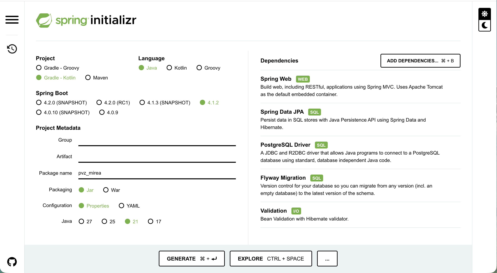

# Отчёт о внесённых изменениях — 02.11.2026

Автор: Владимир Новиков.

Подготовлен проект серверной части системы управления ПВЗ в Spring Initializr. Выбраны Java 21, Spring Boot 4.1.2, сборка Gradle с Kotlin DSL, упаковка JAR и конфигурация в формате Properties. Имя пакета — `pvz_mirea`.

В состав проекта включены зависимости:

- Spring Web — для REST API.
- Spring Data JPA — для работы с данными через сущности и репозитории.
- PostgreSQL Driver — для подключения к PostgreSQL.
- Flyway Migration — для управления миграциями базы данных.
- Validation — для проверки входящих данных.

## Параметры создания проекта

## Разработана структура базы данных 
[Ссылка](https://sqltoerdiagram.com/#s=zxVp9b9s2Gv8qhHCAE8DJOWmSNulawHXU1jdb9sly127dCarNNUIdS5XkdOmQQ5Og1w4tVtxwwP1zuO1wXyDLmsV9ifsVyG90eEhKol7sOGt2818yyefh88qHP5LfKJbrKmtK917Xvm8pRWULe77t9JW1haLiP-wpa8rcHCI_kgO6Sz6QId0lB-SEDMkRIkNEd-kTMiJvEflARuQd3afPyBF001eIDMkJ3SNH9An5QJ-QI7pHhvQJ3aff0T26CwMOkTrwHBf_se74HefR_N3-3X5FV8uGiozytZqKPHzfdvo-mrnbRwghu4uuVW9UNQPdUDVVLxvqOrp2B62r18vtmoHKLVRdVzWjatxBTb1aL-t30KfqnSIn7lubGN0q65WbZX1mYbk0i7SGgbR2rYbaWvXPbVWMqzS0lqGXYZbOA1NIYDLqyk218imauRd49uYMtMyiT66iQmH2bn_2ckZ4d-vxbyy4GGB1ux72fWSot410H5ffjAWIlNbV66quahW1FZvZ7s4Kuo7lWh072DZd7JkbzsBDVc1Qb6h6egLbN61OYG9hdK3RqKllLZ4hVM_QxxjX3Xp8imHHkoU6JyhF46nEoXIhdVbZq6iUdmpVW1dvI_trxoFbDDU07uXIyvlhYPqdDdwd9PD5RDJwnOxQJlTszEcYP-ha26hVL9dqMo3od1zcNwN7EyOjWlfRZ1XjZqNt8D-fNzQ1Pb7Tc3x8FgLJBYOHZsIiJgjGExDNcM2KocDjPRiTh7oJV4Z_r6nGZ6qqoRIqa-toZRpOdj_A3pbVC1nFVvlE0ngqmTacHmaBFAUoJ4KfetvQyxVjpl7V2oaKruuNeuyAWXQFleKxIHs4vqVWGtr69ONl_pL4002QS5C_zA187J1PXPec-3Y_XulKY5do1_L9R47XNTcsfyMiWFxeziyNXw16PTOxgOaN8pyeNCC7wCYTbnyeZRbbyWvsxyydzOomt1hiDWRNE1dATpq0YYJFomsKVrGRE2yi5ilYgAdMv-O4OJswM8w9V1BBrTdrjTuqWmBhK5xSbcVWg-bYB9DTrtVmY04NPWbWajdV_Va11dAz7PJZiUnGsCtr5dqdljElr5jP2CojvLT1GIqMyDHOF8bnj46rkiCYVJf8wPGs-9js4F7vd6pL_cHmPTx2ZxFV5Z4dgDZau67q1crMwmIRXcjk6K9OpsFDM2EKU0iVrkm8ORQd9sT_ISO6S_fIATkkJ2RE3iDylryj39FnfDt8TA7ZpvgV7H0ROSYHYiP8LTmge_Ql7J536QvyjrwlQ0ROyAGir9gG-g1roc_oPvmFMaZ7ZESfQev86QrYXRY3oQIgvIic3AzM1V5kofgH26EpaNP7qjhV0r68Kgpzuh0WCs3SCmtrwtuTKo-_YbubuB-cT_R2nC6eqvicNcrBNjGFaNxyeoNNPF1o-4EVDPxItguyaKFuBfV2U60Y6nohFNPuPBi45rRaeTgYeP2phwvuXWx1e3Yfo_WyEXZ1PGwFuGtaAdsPtoxyvWl8npW40tZ1VTPMaJCgH7jdj6JPZUYYI2fKiq8eSITMf0B6vaGr1RsaxAyaEV6NmMSxLkVCao09NRPjOcEPiWoKLRMLaUwsuz5Z2OOOKVnJYZFgJXVMyYpHfHZpSGZCuDAkW8ctC6dMKRInM6Vor2poRsobVGgZDZ1_VVutNv_SVaOta2bcFTbcrDab6nphdjpR3J7VwfCZs7-RxcnOwxtm-XIplpLx-5FxqmUVCuXPMJY2J9MFWrQKjDM0uE_oAUKmySRtTtkUSVMD4OLcG5pcCcJyzTvz9krJzE6RC0NMpksrkC9BapSw6Wc3VV0NDXMlsku2uokM69q-awWdjd_r7CBVfBZzi8-6Xr5uFFIF4N72pGnEDlWaaMN23QTZpNEfW2XC2ZL0uSUk44izbrCyDMCoeUgnDgtuUZabkqgyopDslY90pBgTuZ7HTsZOKZbJFWZa3aB6R2uuNNnVK5LTxmZ4ll8y03OyIpvxkzPJtAO8GWVT3JrJCilUILXHjzhzUkl5iWYkCYryZDLU-B7VbzURGdE9BiEAcbzjB-1wDg9NI_qUjMhrMgSowT7ICaJ_I0PAJIghkWNyCLSAWHJRRK6domUvCvccEZNbp3w-4d_kNiqh_KStVI7jT9vCnaJPQg5JqVO2dPFCnxiaE3eOiz0rOLcLjDNH2dwcqrRuIfIaMChi1zYH5B1ECIsKBjmPEN1l4QLXNL-I6MmPsmF4yfOSHJMROWSRdAS85-NA_Qefa0Q-MI4HLALfIEC1AH3JMSo3q9D_EzkI-b0S2Bj-kBP6KrogoruM6pDdOo3I-_lxCRlCBx97-advmfqRTXvREfi_rqAE2y7OhWjhSaTnbJpZJBdSO-P7GGUuiAyc_HYPW77TZ_dBuYkRB2aUDVmA85EZcdrEkQMyE_-WS4IkQGzWjASyxc8P4CWnD32XmTx26rliS3nq7bxjVtbKcIOuVtRq04hgA3xU2i2jUVd1k8MHCUisV1vNslG5ORkJpQ0_DprJnb89Pkv6Y5xMcdf_VaIoD_L9Ja9g4b6woXM3Xsl65xRkJc0LURSwzZZcwMJdVpCLqfJWlCyPxJJyKqNow5DiIimeU3Sx5zkeXIycT9F1Op2B530M0HAGXmfi7dIZqta0F1FwEu4kr9JEDzfP-GO-bAXJFDK7h_ltj1RfPOeRmTzNz43u2DmmsEuIE_g_ll-NJjip2mCLTLXebOhGYTY_WyR-2SOqWNWJJ1QSD6F16qAL2qbm4DwKySWTTHpNIBGzxIP75oaWCOMw9aRYzAl8u4s3XSfA_c626eGHA-yf08F4Kj6nAvOyMA_w9uTbVy5s8jJ3ZSkzbiMIXHMTBxtOV4rdsexcK9gY8yTGd52-j8NFfdyriGjcPae7jf7UamjXMldUH3kKkcRfeR5kN3vMhCH8Eu4opm2cH5u5PIFdIsjTrCZFey5H-RI54c-_osJfvijNrVpzX335zcrSzh_OwjX0QMw56bnwkcdCiR8aL6-uxnnWqNdVzYBcqjRq7bqW3DDNh6tVCxXIDwx5jDj-YZDmJTmhL-BCD-713gMKKSK6z5DQWwBR8YBDckL36R59AvjoB_I9-Sec5WVnd7cez-c8qmpxYxTIv8iIfgvTwZUifRmiNoahdukz-neA7eySkPwMr-jIMUC4yxz8H5FD-oI-j7EaALvkhSO_g0zismG-qNGGfj57UhuK-wMIytDhazbnGxD4iJyA5DlPAQ_Dm1HZwmRUTD4AvIwA6bE3g89SusBshww2gpteC33i61K6n9IlA8Fj2f_LXjIe0efMhwIB_0RfsAeKry6j1NYpRKdDdll7yKfmDxgFsoaQAKFG5GcyysXPDBPTPdl1ufJKy34s77_pczIkP3HInkbW0DYk78Ho9AnEyOUEbBbme80i_BcQJqMOD7cP5IA95XzHGLKbbDA_POGkuzA1sHkLRwX0Ra7oufUnVuJHAP90HzwPUsoX4uDbA-YF-pSZ7YRfmXMbwykD5CCId0JGCHQakmPIStCNW5e8h1ygT8GrcrSJsH_PXp-OyOsi5Ms-13iIeCiSET99V4pK17Z6uBMoa4rr-MF9D_tKET5tFkLK2jeKeMYDn18rawvLq6tFZVtZW1i4tLJTVNytx2HP4sJF1rOyvMw74vdhYsilZT5iqbRTVFgFDTsWONPV0qWdopJYtsIRJU66yGijfBW9SyVOv7i6tFNUMig5HLV4iY26uHwxO4qflYmRyyts4KULoEmcUdFsXIvlCztFJY7faJYlbqALK6BMXpBEfMTI0lJpZ6eodKxN7Fmi8yKXdW5lsaj4HauHlbXS_NKFS8DT6vedIBTpiy-Lyobd7eI-_960-gOrV7P7D1jnzv8A)
